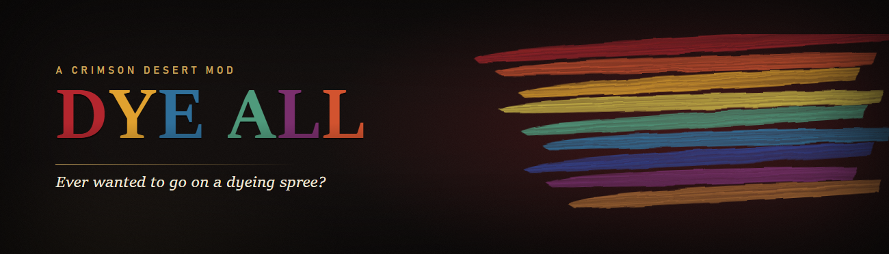
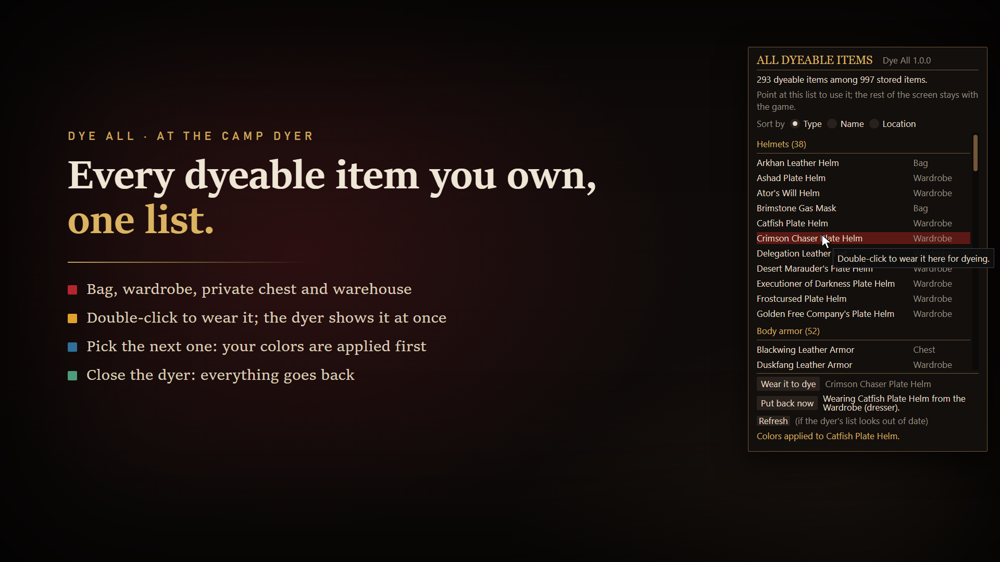
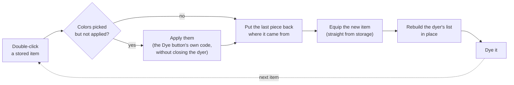

<p align="center">
  
</p>

<p align="center">
  <em><b>Ever wanted to go on a dyeing spree, not limited to what you have equipped?</b></em>
</p>

<p align="center">
  <a href="../../releases/latest"></a>
  
  
  <a href="LICENSE"></a>
</p>

The camp dyer in Crimson Desert only shows what you are wearing. To dye a stored piece you leave the dyer,
equip it, come back, dye, and put it away again. **Dye All** lists **every dyeable item you own** right on
the dye screen and puts any of them on for you, without ever leaving the menu. That's why it exists.

<p align="center">
  
</p>

## Features

| | |
|---|---|
| 🟥 **Everything in one list** | Bag, wardrobe, private chest and warehouse, sorted by type, name or location. |
| 🟨 **One double-click** | The item goes on and the dyer shows it immediately. No menu exits, no tab switching. |
| 🟦 **Dye in a row** | Pick colors, pick the next item: your colors are applied first and the dye screen stays open. |
| 🟩 **All gear** | Armor, cloaks, weapons, shields, horse gear and A.T.A.G. parts. |
| 🟪 **Puts itself away** | Close the dyer and everything goes back after 10 seconds: your own gear on, each dyed piece back where it came from. |
| 🟧 **Full bag? No problem** | Items go on straight from storage. |
| ⬜ **Plays fair** | Never makes an item dyeable that the game doesn't allow. The dyer charges its normal price, once per item. |

## How to use

1. At a camp dyer, choose **Dye**. The Dye All panel appears on the right.
2. Double-click the item you want. Horse gear: **RB** to the horse tab. A.T.A.G. parts: **RB** twice.
3. Pick colors, then double-click the next item. For the last one, press Dye.
4. Close the dye screen. Everything goes back on its own.

<kbd>F7</kbd> shows the panel anywhere; <kbd>F7</kbd> or <kbd>Esc</kbd> gives the mouse back to the game.

## Install

1. Download `DyeAll_1.0.0.zip` from [Releases](../../releases/latest).
2. With **DMM**: drag the zip onto DMM, enable **DyeAll** on the ASI tab, mount, start the game.

Requires **Crimson Desert 1.0.0.3663**. To remove it, disable or remove DyeAll in DMM.

## Safety

The mod only uses the game's own move, equip and dye requests, one step at a time, and checks your
inventories after each one. If a step fails it stops and tells you: the item is either worn or in your bag,
**never lost**. Every step is written to `DyeAll.log` in the game's `bin64` folder.

After a game update the mod checks the game's code before every hook and switches off whatever no longer
matches instead of guessing.

<details>
<summary><b>Good to know</b></summary>

**What does it cost?** The dyer's normal price, once per item. The game charges per Dye press, and the mod
presses it for each item in your spree.

**Why are some items greyed out?** Crossbows: no character has a slot for them. A.T.A.G. parts: the dyer
only has an A.T.A.G. tab once you own an A.T.A.G.

**A weapon went straight back?** Your current character can't use it, so the game refuses it and the mod
returns it to where it came from.

**The dyer's list looks out of date.** Press **Refresh** in the panel (or RB then LB).

</details>

## How it works

A swap goes through the game's own requests, the same ones its menus send, and the dye screen is refreshed
in place instead of being reopened:



The reverse engineering notes (addresses, structures, request layouts, for game version 1.0.0.3663) are in
[research/FINDINGS.md](research/FINDINGS.md).

## Building from source

Needs Windows, the MSVC Build Tools 2019 (with their bundled CMake and Ninja) and internet access for the
first build, which fetches Dear ImGui and MinHook.

```bat
plugin\build.bat
```

The result is `plugin/build/DyeAll.asi`, also copied to `dist/`. The dyeable item table,
`plugin/data/dyeables.tsv`, is built into the plugin; `tools/build_dyeables.py` regenerates it from the
game's data.

| Folder | What's in it |
|---|---|
| `plugin/` | The ASI plugin: dye screen hooks, the swap state machine, the panel. |
| `tools/` | Research helpers (static analysis of the exe, live memory peeks) and `checklog.py`, which grades a `DyeAll.log` against [TESTS.md](TESTS.md). |
| `research/` | Reverse engineering notes. |
| `page/` | Sources of the banner and gallery images, and the Nexus page text. |

## Bugs

Open an [issue](../../issues) and attach `DyeAll.log` from the game's `bin64` folder, taken right after it
happened. It records every step the mod took.

## Credits

- Made with **[Claude](https://claude.ai)** (Anthropic's AI assistant), which did the reverse engineering and
  wrote the code together with me.
- Overlay, input, memory and game-event code adapted from **Master Looter** by Seth (MIT), which adapted its
  overlay from **[Trinity](https://github.com/XeTrinityz/Trinity)** by XeTrinityz (MIT).
- [MinHook](https://github.com/TsudaKageyu/minhook) (BSD 2-clause), [Dear ImGui](https://github.com/ocornut/imgui) (MIT).

## License

[MIT](LICENSE). Adapted parts keep their own MIT notices: [plugin/LICENSE.MasterLooter.txt](plugin/LICENSE.MasterLooter.txt),
[plugin/THIRD_PARTY_NOTICES.md](plugin/THIRD_PARTY_NOTICES.md).

<sub>Not affiliated with Pearl Abyss. Crimson Desert is a trademark of Pearl Abyss.</sub>
